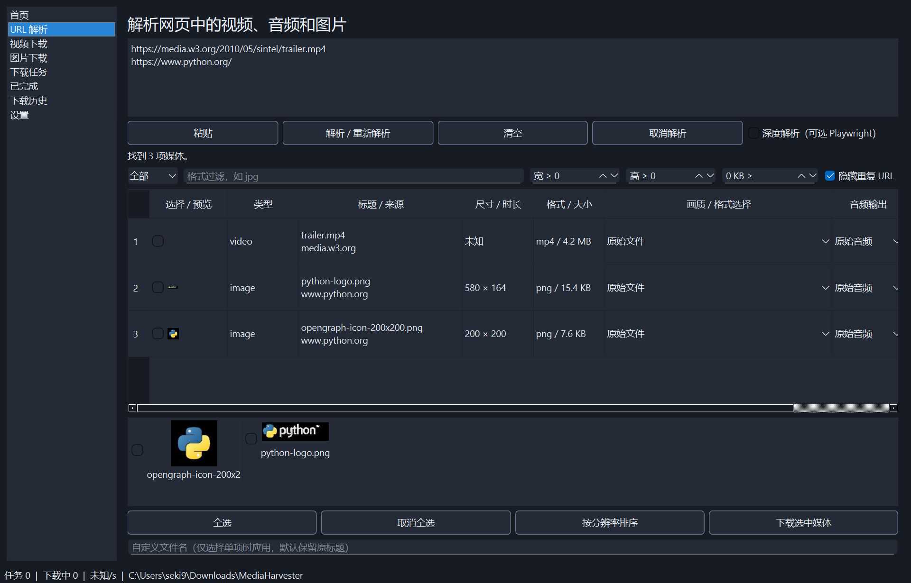

# MediaHarvester

Windows 11 媒体下载桌面程序，使用 PySide6、yt-dlp、httpx、SQLite。
这是实际可运行的首版，核心是可靠的 HTTP 续传和持久化任务。



## 已实现

- 多行 URL 后台解析，按真实 Content-Type 识别直接图片、视频、音频。
- yt-dlp Python API 元数据、播放列表条目、实际格式选择；纯视频自动配音轨。
- FFmpeg 合并与 MP3/M4A/Opus 音频转换，分离下载结束不会提前标为完成。
- HTML 图片 src/srcset、picture、懒加载、行内背景、OG，明确最高分辨率候选优先。
- 异步预览、缩略图展示、格式/宽高/大小筛选、全选、分辨率排序、批量下载。
- 后台并发队列、限速、暂停/继续/取消/重试、完成/历史视图、系统托盘通知。
- SQLite WAL + FULL、临时文件、HTTP Range 验证、提交日志、重启恢复、SHA-256 图片去重。
- aria2 可选后端及原生控制文件，缺失时使用 httpx；深度解析可选 Playwright。
- 设置持久化、深浅/系统主题、Windows 文件名处理、重名自动编号。
- HTTP/DNS/重定向公网限制，外部引擎使用有认证的临时代理，不读取浏览器 Cookie。

## 运行

开发环境需要 Python 3.11+；EXE 自带解释器，直接双击。

```powershell
python -m venv .venv
.\.venv\Scripts\Activate.ps1
python -m pip install -r requirements.txt
python main.py
```

解析后勾选媒体，视频选择实际格式，再点击“下载选中媒体”。
网站视频提取音频时先选“仅音频”轨，再选转换格式；直接文件支持下载后提取音频。
下载目录、默认画质、合并容器和命名方式可在设置页修改。
程序数据位于 `%LOCALAPPDATA%\MediaHarvester`，下载临时数据位于
`下载目录\.mediaharvester\任务ID`；删除任务记录保留文件，避免误删数据。

## 辅助程序与构建

合并、转换需要 FFmpeg/FFprobe，可从 [FFmpeg 官网](https://ffmpeg.org/download.html)
选择适用 Windows 构建，加入 PATH；aria2 可从
[官方仓库](https://github.com/aria2/aria2/releases) 获取，加入 PATH。
也可放到项目 `tools/`，但分发时必须提供适用许可证和对应源码。

可选深度解析：

```powershell
python -m pip install playwright
python -m playwright install chromium
```

Playwright 在源码运行时按需启动单个无头浏览器，20 秒导航、5 次滚动、45 秒总超时；
无法绕过登录、CAPTCHA 或 DRM。本次 EXE 未包含 Playwright/Chromium，深度解析请使用源码版本。

```powershell
python -m pip install -r requirements-build.txt
.\build_exe.ps1
.\build_exe.ps1 -OneFile
```

输出分别为 `dist\onedir\MediaHarvester\MediaHarvester.exe` 和
`dist\onefile\MediaHarvester.exe`。详见 [发布说明](docs/release.md)。

## 恢复机制

关闭时后台任务平稳暂停并保存；再次启动默认手动继续，可在设置开启自动恢复。
HTTP 206 必须核对 Content-Range 和验证标识；不支持 Range 或内容变化时安全重新下载。
断网指数退避最多配置次数，失败保留数据供手动重试。
视频恢复重解析原网页，只有可信的强 ETag 和轨道属性一致才复用分片；
无法证明一致的 HLS/DASH 重新下载，旧文件保存在 previous 中。
提交日志可修复文件已移动但数据库未完成的崩溃窗口。
测试包含异常状态重启；尚未做物理断电实验。

## 网站与限制

网站覆盖范围由 [yt-dlp](https://github.com/yt-dlp/yt-dlp) 的当前提取器和源站规则决定。
普通 HTML 图片、直接 HTTP 文件、yt-dlp 可支持的 HLS/DASH 使用不同后端。
不支持 DRM 解密、登录权限绕过、验证码绕过、私网地址、本地文件 URL、RTMP 与直播录制。
源站 403/429、地域限制、签名变化或删除可能阻止下载，错误会保留在任务列表。

首版限制：主要控件和设置支持英文，部分动态提示仍为中文；日文为翻译结构；外部 CSS 文件背景未遍历；
未知尺寸图片在取得预览之前不能通过最小尺寸筛选；超 8 MB 的图片不生成在线预览，
仍可下载。尚无感知哈希、覆盖/跳过策略，
任务删除不自动清理磁盘。HLS/DASH 不承诺跨会话分片续传。
仅做过宿主 Windows 的 GUI 和 EXE 验证，干净无 Python 虚拟机尚未验证。

## 测试和更新

```powershell
python -m pip install -r requirements-dev.txt
python -m pytest -q
python scripts\smoke_gui.py
python scripts\online_smoke.py
python -m pip install --upgrade yt-dlp
```

测试结果与实际验证范围见 [验证记录](docs/validation.md)。
常见问题：合并失败检查 FFmpeg；缺少格式重新解析；Range 内容变化会重新下载；
源站拒绝不要反复高速重试；深度解析缺少浏览器按上面安装；日志在应用数据目录。
依赖升级需重跑续传、GUI、打包测试；`requirements-lock.txt` 记录本次验证版本。

## 项目结构

```text
mediaharvester/
  app.py / ui.py / config.py     Qt、设置、启动
  extractors.py / models.py      解析插件、格式、媒体与任务模型
  download.py / aria2.py         调度、HTTP、aria2、恢复与提交
  worker.py / proxy.py           隔离 yt-dlp / Chromium、有认证公网代理
  database.py / files.py         SQLite、路径、哈希
  security.py / i18n/            网络安全与翻译结构
tests/ scripts/ docs/            单元测试、实际 smoke、说明与截图
main.py / mediaharvester.spec / build_exe.ps1 / build_exe.bat
```

本项目采用 MIT；Qt、yt-dlp 等依赖保留原许可证，见
[第三方许可](THIRD_PARTY_NOTICES.md)。

### 手动导入网站 Cookie

设置页可选择当前网站的 Netscape 格式 cookies.txt。程序只保存文件路径，按解析地址筛选 Cookie，使用临时副本交给 yt-dlp；不修改原文件，不自动读取浏览器 Cookie，也不在任务元数据中保存 Cookie / Authorization。当前适用于网站媒体解析和下载；匹配 Cookie 时使用网站媒体引擎，Instagram 照片有专门处理，其他站点不采集该页 HTML 图片。清空路径并保存即可停用。Cookie 不保证解决网站返回的 410、访问限制或解析器兼容问题。

网站浏览器兼容请求由 yt-dlp 的 curl-cffi 依赖提供，并随 EXE 打包。普通网页请求失败时会继续尝试网站视频引擎。本次目标链接已在新版 EXE 中不带 Cookie 完成 1080p 下载验证。

### Instagram 图片帖子

支持单图和轮播照片：使用 Instagram 解析器返回的实际照片候选，选择面积最大的版本；不会把头像或视频封面当成帖子图片。需要登录才能访问的帖子使用设置中选定的本地 Instagram Cookie 文件，仍由网站验证账号访问权限。解析轮播帖会列出全部照片，可在图片列表中选择下载。

### 自动读取本机浏览器登录态

设置中的“需要登录时自动读取本机浏览器 Cookie”默认开启，可关闭。浏览器可选 auto、Chrome、Edge、Firefox、Brave、Vivaldi。先尝试当前手动 Cookie / 普通请求，只有媒体引擎明确报告需要登录时才查找当前 Windows 用户下标准浏览器配置目录，逐个尝试配置；每次仅把当前网站有效 Cookie 交给媒体引擎。成功后任务只记住浏览器和配置路径，视频下载时重新读取最新 Cookie，不保存 Cookie 值或密码。不会读取浏览器密码数据库或自动退出浏览器。浏览器占用或系统加密保护可能阻止读取，提示正常退出后重试或手动导入；网站仍验证账号访问权限。非标准自定义配置路径、其他浏览器和无法识别登录状态的网页可能需要手动导入。

### 在界面直接粘贴 Cookie

URL 解析页的地址框下面新增“登录 Cookie（需要时粘贴）”。先输入同一网站的地址，把开发者工具 Network 请求头中整行 Cookie 的值粘贴到隐藏输入框，点击“应用 Cookie”，再重新解析。可带 Cookie: 前缀；不能只粘贴单个值、整个请求头块或 JSON。程序自动转换并仅保存在当前 Windows 用户的本地应用目录，记住路径，应用后清空输入框。不同网站分别应用，保留各站登录态；Instagram 同域媒体 API 可使用该会话。点击“停用 Cookie”可停止使用手动 Cookie（自动浏览器读取仍按设置运行）。当前 EXE 禁用未包含的 Playwright 深度解析选项。
